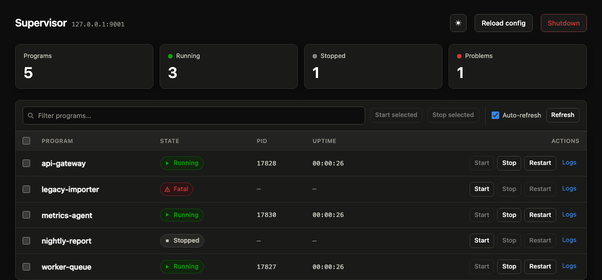
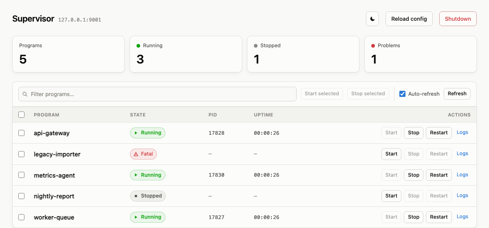

[](https://goreportcard.com/report/github.com/ochinchina/supervisord)

> **This is a fork of [ochinchina/supervisord](https://github.com/ochinchina/supervisord)**, branched at
> `16cb640`. It hardens the HTTP interface, fixes several concurrency and
> configuration-reload defects, and replaces the web GUI. Some of it changes
> behaviour you may be relying on — see [Differences from upstream](#differences-from-upstream)
> before you drop this binary in place of the upstream one.

# Why this project?

The python script supervisord is a powerful tool used by a lot of guys to manage the processes. I like  supervisord too.

But this tool requires that the big python environment be installed in target system. In some situation, for example in the docker environment, the python is too big for us.

This project re-implements supervisord in go-lang. Compiled supervisord is very suitable for environments where python is not installed.

# Building the supervisord

Go 1.21+ is required (`go.mod` declares 1.24).

**`-tags release` is not optional.** It selects `assets_release.go`, which embeds
`webgui/` into the binary with `//go:embed`. Without it you get `assets_dev.go`,
which serves the GUI from `./webgui` *relative to the working directory the
daemon was started in* — so the GUI 404s for anything but a build run from the
source tree. There is no `go generate` step any more; the embed replaced it.

Linux:

```shell
GOOS=linux go build -tags release -a -ldflags "-linkmode external -extldflags -static" -o supervisord
```

Windows:

```shell
GOOS=windows go build -tags release -o supervisord.exe
```

Or use the [Task](https://taskfile.dev) targets, which pass the tag for you:

```shell
task build          # host platform
task buildvendor    # host platform, from vendor/
task buildwin       # windows/amd64 (from a non-Windows host)
```

### If you edit anything under `process/`, `config/`, `logger/`, …

This repo `replace`s its own sub-packages to local directories, **and** vendors
them. Because `go.mod` declares `go 1.24` and a `vendor/` directory exists, Go
resolves through `vendor/` **even when you do not pass `-mod=vendor`**. Editing
`process/process.go` and rebuilding therefore produces a binary without your
change, silently.

```shell
go mod vendor       # run this after editing any sub-package, before building
```

Files in `package main` at the repo root (`supervisor.go`, `xmlrpc.go`, …) are
not vendored and need no such step. `vendor/` is gitignored, so a fresh clone has
none and `task buildvendor` will fail until you run `go mod vendor` once.

# Run the supervisord

After a supervisord binary has been generated, create a supervisord configuration file and start the supervisord like this:

```Shell
$ cat supervisor.conf
[program:test]
command = /your/program args
$ supervisord -c supervisor.conf
```

Please note that config-file location is autodetected in this order (see
`findSupervisordConf` in `main.go`):

1. the path given to `-c`
2. ./supervisord.ini
3. ./etc/supervisord.conf
4. /etc/supervisord.conf
5. /etc/supervisor/supervisord.conf (since Supervisor 3.3.0)
6. ../etc/supervisord.conf
7. ../supervisord.conf
8. ./supervisord.conf

The relative entries are resolved against the **current working directory**, not
the executable. A config file whose name is not on that list — say
`supervisord_myhost.conf` — is never found automatically, so `-c` is required
both for the daemon and for every `supervisord ctl` invocation.

If the file cannot be read, supervisord logs the reason and exits non-zero
rather than starting up and supervising nothing. See
[Differences from upstream](#differences-from-upstream).


# Run as daemon with web-ui

Add the inet interface in your configuration:

```ini
[inet_http_server]
port=127.0.0.1:9001
```

then run

```shell
$ supervisord -c supervisor.conf -d
```

In order to manage the daemon, you can use `supervisord ctl` subcommand, available subcommands are: `status`, `start`, `stop`, `shutdown`, `reload`.

```shell
$ supervisord ctl status
$ supervisord ctl status program-1 program-2...
$ supervisord ctl status group:*
$ supervisord ctl stop program-1 program-2...
$ supervisord ctl stop group:*
$ supervisord ctl stop all
$ supervisord ctl start program-1 program-2...
$ supervisord ctl start group:*
$ supervisord ctl start all
$ supervisord ctl shutdown
$ supervisord ctl reload
$ supervisord ctl signal <signal_name> <process_name> <process_name> ...
$ supervisord ctl signal all
$ supervisord ctl pid <process_name>
$ supervisord ctl fg <process_name>
```

Please note that `supervisor ctl` subcommand works correctly only if http server is enabled in [inet_http_server], and **serverurl** correctly set. Unix domain socket is not currently supported for this pupose.

Serverurl parameter detected in the following order:

- check if option -s or --serverurl is present, use this url
- check if -c option is present, and the "serverurl" in "supervisorctl" section is present, use "serverurl" in section "supervisorctl"
- check if "serverurl" in section "supervisorctl" is defined in autodetected supervisord.conf-file location and if it is - use found value
- use http://localhost:9001

# Check the version

Command "version" will show the current supervisord binary version.

```shell
$ supervisord version
```

# Supported features

## Http server

Http server can work via both unix domain socket and TCP. Basic auth is
supported and, off loopback, required.

The unix domain socket setting is in the "unix_http_server" section.
The TCP http server setting is in "inet_http_server" section.

If both "inet_http_server" and "unix_http_server" are not set up in the configuration file, no http server will be started.

This interface can start and stop processes, write to their stdin, reload the
configuration and shut the daemon down, so it is treated as a control plane:

- **Every** route is behind basic auth when a username and password are set —
  including `/metrics` and the per-program log directories.
- **Binding to a non-loopback address without a username and password is
  refused.** The listener does not start; supervisord keeps running so a bad
  HTTP setting never takes the managed processes down with it. Loopback binds
  without credentials are allowed with a warning. Set `allow_no_auth=true` in
  `[inet_http_server]` to get the old behaviour back.
- The unix socket is chmod'ed to `0700`, so only its owner can drive it.
- Credentials are compared in constant time. `{SHA}<sha1-hex>` password digests
  are still accepted, as in the python implementation.
- State-changing REST calls must not look cross-origin: if `Origin` is present
  it has to match `Host`, and the `Content-Type` must not be one an HTML form
  can produce. Send `application/json`. `/RPC2` is unaffected — gorilla/rpc
  already requires `text/xml`.

There is no TLS. Terminate it in front of supervisord if the interface leaves
the host.

## Supervisord daemon settings

Following parameters configured in "supervisord" section:

- **logfile**. Where to put log of supervisord itself.
- **logfile_maxbytes**. Rotate log-file after it exceeds this length.
- **logfile_backups**. Number of rotated log-files to preserve.
- **loglevel**. Logging verbosity, can be trace, debug, info, warning, error, fatal and panic (according to documentation of module used for this feature). Defaults to info.
- **pidfile**. Full path to file containing process id of current supervisord instance.
- **minfds**. Reserve al least this amount of file descriptors on supervisord startup. (Rlimit nofiles).
- **minprocs**. Reserve at least this amount of processes resource on supervisord startup. (Rlimit noproc).
- **identifier**. Identifier of this supervisord instance. Required if there is more than one supervisord run on one machine in same namespace.

## Supervised program settings

Supervised program settings configured in [program:programName] section and include these options:

- **command**. Command to supervise. It can be given as full path to executable or can be calculated via PATH variable. Command line parameters also should be supplied in this string. 
- **process_name**. the process name
- **numprocs**. number of process
- **numprocs_start**. ??
- **autostart**. Should be supervised command run on supervisord start? Defaults to **true**.
- **startsecs**. The total number of seconds which the program needs to stay running after a startup to consider the start successful (moving the process from the STARTING state to the RUNNING state). Set to 0 to indicate that the program needn’t stay running for any particular amount of time.
- **startretries**. The number of serial failure attempts that supervisord will allow when attempting to start the program before giving up and putting the process into an FATAL state. See Process States for explanation of the FATAL state.
- **autorestart**. Automatically re-run supervised command if it dies.
- **exitcodes**. The list of “expected” exit codes for this program used with autorestart. If the autorestart parameter is set to unexpected, and the process exits in any other way than as a result of a supervisor stop request, supervisord will restart the process if it exits with an exit code that is not defined in this list.
- **stopsignal**. Signal to send to command to gracefully stop it. If more than one stopsignal is configured, when stoping the program, the supervisor will send the signals to the program one by one with interval "stopwaitsecs". If the program does not exit after all the signals sent to the program, supervisord will kill the program.
- **stopwaitsecs**. Amount of time to wait before sending SIGKILL to supervised command to make it stop ungracefully.
- **stdout_logfile**. Where STDOUT of supervised command should be redirected. (Particular values described lower in this file).
- **stdout_logfile_maxbytes**. Log size after exceed which log will be rotated.
- **stdout_logfile_backups**. Number of rotated log-files to preserve.
- **redirect_stderr**. Should STDERR be redirected to STDOUT.
- **stderr_logfile**. Where STDERR of supervised command should be redirected. (Particular values described lower in this file).
- **stderr_logfile_maxbytes**. Log size after exceed which log will be rotated.
- **stderr_logfile_backups**. Number of rotated log-files to preserve.
- **environment**. List of VARIABLE=value to be passed to supervised program. It has higher priority than `envFiles`.
- **envFiles**. List of .env files to be loaded and passed to supervised program. 
- **priority**. The relative priority of the program in the start and shutdown ordering
- **user**. Sudo to this USER or USER:GROUP right before exec supervised command.
- **directory**. Jump to this path and exec supervised command there.
- **stopasgroup**. Also stop this program when stopping group of programs where this program is listed.
- **killasgroup**. Also kill this program when stopping group of programs where this program is listed.
- **restartPause**. Wait (at least) this amount of seconds after stopping supervised program before starts it again.
- **restart_when_binary_changed**. Boolean value (false or true) to control if the supervised command should be restarted when its executable binary changes. Defaults to false.
- **restart_cmd_when_binary_changed**. The command to restart the program if the program binary itself is changed.
- **restart_signal_when_binary_changed**. The signal sent to the program for restarting if the program binary is changed.
- **restart_directory_monitor**. Path to be monitored for restarting purpose.
- **restart_file_pattern**. If a file changes under restart_directory_monitor and filename matches this pattern, the supervised command will be restarted.
- **restart_cmd_when_file_changed**. The command to restart the program if any monitored files under **restart_directory_monitor** with pattern **restart_file_pattern** are changed.
- **restart_signal_when_file_changed**. The signal will be sent to the proram, such as Nginx, for restarting if any monitored files under **restart_directory_monitor** with pattern **restart_file_pattern** are changed.
- **depends_on**. Define supervised command start dependency. If program A depends on program B, C, the program B, C will be started before program A. Example:

```ini
[program:A]
depends_on = B, C

[program:B]
...
[program:C]
...
```

## Set default parameters for all supervised programs

All common parameters that are identical for all supervised programs can be defined once in "program-default" section and omitted in all other program sections.

In example below the VAR1 and VAR2 environment variables apply to both test1 and test2 supervised programs:

```ini
[program-default]
environment=VAR1="value1",VAR2="value2"
envFiles=global.env,prod.env

[program:test1]
...

[program:test2]
...

```

## Group

Section "group" is supported and you can set "programs" item

## Events

Supervisord 3.x defined events are supported partially. Now it supports following events:

- all process state related events
- process communication event
- remote communication event
- tick related events
- process log related events

## Logs

Supervisord can redirect stdout and stderr ( fields stdout_logfile, stderr_logfile ) of supervised programs to:

- **/dev/null**. Ignore the log - send it to /dev/null.
- **/dev/stdout**. Write log to STDOUT.
- **/dev/stderr**. Write log to STDERR.
- **syslog**. Send the log to local syslog service.
- **syslog @[protocol:]host[:port]**. Send log events to remote syslog server. Protocol must be "tcp" or "udp", if missing, "udp" assumed. If port is missing, for "udp" protocol, it's defaults to 514 and for "tcp" protocol, it's value is 6514.
- **file name**. Write log to specified file.

Multiple log files can be configured for the stdout_logfile and stderr_logfile with ',' as delimiter. For example:

```ini
stdout_logfile = test.log, /dev/stdout
```

### syslog settings

if write the log to the syslog, following additional parameter can be set like:
```ini
syslog_facility=local0
syslog_tag=test
syslog_stdout_priority=info
syslog_stderr_priority=err
```
- **syslog_facility**, can be one of(case insensitive): KERNEL, USER, MAIL, DAEMON, AUTH, SYSLOG, LPR, NEWS, UUCP, CRON, AUTHPRIV, FTP, LOCAL0~LOCAL7
- **syslog_stdout_priority**, can be one of(case insensitive): EMERG, ALERT, CRIT, ERR, WARN, NOTICE, INFO, DEBUG
- **syslog_stderr_priority**, can be one of(case insensitive): EMERG, ALERT, CRIT, ERR, WARN, NOTICE, INFO, DEBUG


# Web GUI

Supervisord has a builtin web GUI: you can start, stop, restart and check the
status of every program from it, filter the list, and browse each program's log
directory.





It follows the operating system's light/dark setting and has a toggle that
overrides it. Program state is read from supervisord's numeric state and shown
as an icon plus a label, so `Stopped` (a deliberate outcome) does not look like
`Fatal`.

The GUI is **self-contained**: no jQuery, no Bootstrap, no CDN, no outbound
request of any kind. Together with `-tags release` this means a single binary
and a config file are enough — the GUI works on an air-gapped host with nothing
else on disk.

To use it, configure `[inet_http_server]` (and/or `[unix_http_server]`), plus
`[supervisorctl]` if you also want the `ctl` subcommand:

```ini
[inet_http_server]
port=127.0.0.1:9001
;username=test1
;password=thepassword

[supervisorctl]
serverurl=http://127.0.0.1:9001
;username=test1
;password=thepassword
```

`[supervisorctl]` needs its own copy of the credentials — `supervisord ctl` does
not read them from `[inet_http_server]`. If `[inet_http_server]` has a password
and `[supervisorctl]` does not, every `ctl` command fails with
`Bad response with status code 401`.

To reach the GUI from another machine, bind to a routable address **and** set a
username and password; a non-loopback bind without credentials is refused. Note
`*:9001` does not work — the address is passed to `net.Listen` unchanged, so use
`0.0.0.0:9001`.

# Differences from upstream

Branched from [ochinchina/supervisord](https://github.com/ochinchina/supervisord)
at `16cb640`. Everything below is this fork.

## Behaviour that changed — read this before upgrading

These five can break a working setup. The rest of the list only fixes things.

| Change | What breaks |
|---|---|
| A non-loopback bind with no `username`/`password` is refused | An `[inet_http_server]` on `:9001` or `0.0.0.0:9001` with no credentials stops listening. supervisord itself keeps running. Set credentials, bind to `127.0.0.1`, or set `allow_no_auth=true`. |
| A config file that cannot be read is fatal at startup | Upstream started anyway and supervised nothing. This exits non-zero with the reason. A wrong `-c` path now fails loudly instead of looking like a hung service. |
| State-changing REST calls are checked for cross-origin | A client posting `application/x-www-form-urlencoded` gets 415. Send `application/json`. Behind a reverse proxy, pass the original `Host` (`proxy_set_header Host $host;`) or the `Origin` check rejects the request. |
| The config editor page is gone | `/confFile` and `/conf/{program}` now 404. It never saved anything — the Save button had no handler and no route wrote files — so nothing that worked stopped working. |
| A backslash in a config value is an ordinary character | The ini reader no longer treats `\n`, `\t`, `\\`, `\;`, `\#`, `\=`, `\:` and `\x????` as escape sequences, and no longer drops the backslash from other sequences (`D:\log\app.log` used to become `D:log` + BEL + `pp.log`). Windows paths now work as written. A value that used `\\` to get one backslash now keeps both, and `\;` or `\#` keeps its backslash. A value ending in a single `\` still continues on the next line, so end a path with `/` or add something after it. |

`/metrics` and `/log/<program>/` also require credentials now, which will break
an unauthenticated Prometheus scrape.

## Security

- `/log/<program>/` served the whole directory containing `stdout_logfile`
  without the auth wrapper every other route had. `http.ServeMux` prefers the
  more specific pattern, so it shadowed the authenticated `/` catch-all instead
  of falling through to it. `/metrics` was unwrapped too. (`51e9798`)
- Binding off loopback with no credentials is refused; the unix socket is
  `0700`; credentials are compared with `crypto/subtle`. (`51e9798`)
- CSRF: browsers replay basic auth automatically, so a plain HTML form on
  another origin could reach `/supervisor/shutdown`. State-changing requests now
  have to pass an `Origin`/`Host` check and a `Content-Type` check. (`b0898b1`)
- DOM XSS in the GUI: `log.html` took the program name from the query string and
  inserted the server's response with `$().html()`, so anyone able to write to a
  monitored program's log could run script in an admin's browser. `index.html`
  concatenated program names into markup and into a JavaScript string literal
  inside `onclick`. (`f518420`)

## Correctness

- **Reload dropped nothing.** `Entry.parse` merged into the existing key set and
  `Config.Load` never discarded the previous `Entry`, so deleting a line from
  `supervisord.conf` and reloading left the old value in effect until the daemon
  was restarted. Changing a value worked, which made it hard to notice.
  (`0bb65a7`)
- **A failed reload stopped everything.** `Config.Load` could not report failure
  at all — the ini loader it calls has no error return — so an unreadable config
  yielded an empty program list and a nil error, and `Supervisor.Reload` computed
  "every program was removed" from it and stopped them all, then answered
  `{"success":true}`. (`138510b`)
- **`p.cmd` data race → crash.** `run()` reassigns `p.cmd` on every restart under
  the write lock; `isRunning()` read it without one, from three callers that hold
  no lock. Between the nil check and the dereference the pointer could be
  replaced by the next attempt's command, whose `Process` is still nil, and
  supervisord panicked — taking every managed process with it. (`297bfd4`)
- **`p.state` data race.** `Stop()` was the only caller of `changeStateTo` that
  did not hold the lock, and its wait loop polled `p.state` unsynchronised, so a
  stop could take a time unrelated to `stopwaitsecs`. `GetState`,
  `GetStartTime` and `GetStopTime` took no lock either. (`eb35f6b`)
- **Logger data race → lost output.** The goroutine that closes a program's
  loggers read the fields with no lock and closed whichever logger was installed
  when its wait loop ended — possibly the one the *restarted* process had just
  been given, after which that program's output silently stopped being written.
  Log RPCs also dereferenced the loggers with no nil check, so
  `readProcessStdoutLog` against a never-started program panicked. (`6bb4543`)
- `POST /supervisor/reload` always answered `{"success":false}`, whatever
  happened. (`fe17ce8`)
- `supervisorctl reload` exited 0 and printed nothing when the server had
  refused the reload: `XMLRPCClient.ReloadConfig` is the only method that walks
  the XML by hand instead of using `xml.DecodeClientResponse`, and it never
  looked for a fault element. (`384c81d`)
- `/log` and `/confFile` read their page from `./webgui` relative to the working
  directory even in a release build, so as a Windows service — working directory
  `System32` — they returned a bodyless 404 and the browser showed a blank page
  while the rest of the GUI worked. (`9845bc3`)

## Web GUI

Rewritten (`28f23f4`). jQuery, Popper, Bootstrap, bootstrap-table,
bootstrap-dialog and axios are gone, along with the 3.4 MB of vendored assets
that shipped inside every binary (`47807d9`) — the release binary drops from
20.3 MB to 16.9 MB. Rows are built with `createElement`/`textContent`, so a
program name is never concatenated into markup at all.

Also removed: the config editor (`28d9c26`) and `login.html`, an unmodified
Bootstrap sign-in example that nothing linked to and that could not have
authenticated anything (`4c928a3`).

## Build

- `Dockerfile` could not build at all: `CGO_ENABLED=0` disables the external
  linker that its own `-linkmode external` asks for, so it failed with
  `-linkmode requires external (cgo) linking, but cgo is not enabled`. The
  ldflags were also unnecessary — `CGO_ENABLED=0` already yields a static
  binary. Both Dockerfiles were additionally missing `-tags release`, so even a
  successful build produced an image whose GUI answered 404.
- `Taskfile.yml` for local builds (`461707c`).

## Housekeeping

The remaining Chinese comments and GUI strings translated to English
(`a3f206f`).

# Usage from a Docker container

supervisord is compiled inside a Docker image to be used directly inside another image, from the Docker Hub version.

```Dockerfile
FROM debian:latest
COPY --from=ochinchina/supervisord:latest /usr/local/bin/supervisord /usr/local/bin/supervisord
CMD ["/usr/local/bin/supervisord"]
```

Note that `ochinchina/supervisord:latest` is upstream's image and carries none of
the changes listed under [Differences from upstream](#differences-from-upstream).

To build your own from this repo:

```shell
docker build -t supervisord:local .
```

Inside a container you will want to bind the HTTP interface to `0.0.0.0` so it
is reachable through the published port — and a non-loopback bind **requires a
username and password**. Without them supervisord logs `refuse to listen on a
non-loopback address without username/password` and serves nothing, while the
container itself stays up:

```ini
[inet_http_server]
port=0.0.0.0:9001
username=admin
password=secret
```

```shell
docker run -d -p 9001:9001 -v /path/to/conf:/cfg supervisord:local -c /cfg/supervisord.conf
```

The resulting image is a `scratch` image holding one static binary, about
17 MB, with the web GUI embedded in it.

# Integrate with Prometheus

The Prometheus node exporter supported supervisord metrics are now integrated into the supervisor. So there is no need to deploy an extra node_exporter to collect the supervisord metrics. To collect the metrics, the port parameter in section "inet_http_server" must be configured and the metrics server is started on the path /metrics of the supervisor http server.

For example, if the port parameter in "inet_http_server" is "127.0.0.1:9001" and then the metrics server should be accessed in url "http://127.0.0.1:9001/metrics" 


# Register service

Autostart supervisord after os started. Look up supported platforms at [kardianos/service](https://github.com/kardianos/service).

```Shell
# install
sudo supervisord service install -c full_path_to_conf_file
# uninstall
sudo supervisord service uninstall
# start
supervisord service start
# stop
supervisord service stop
```

